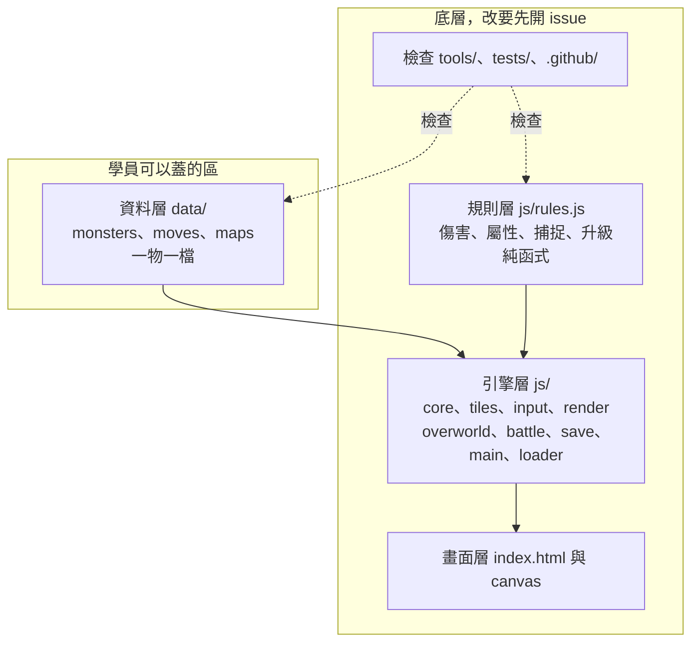
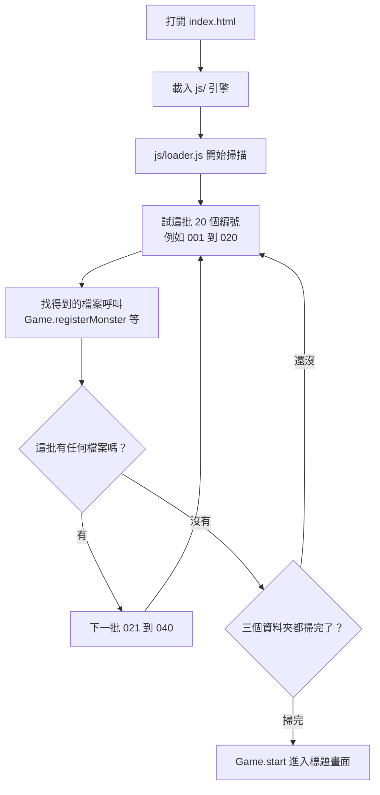
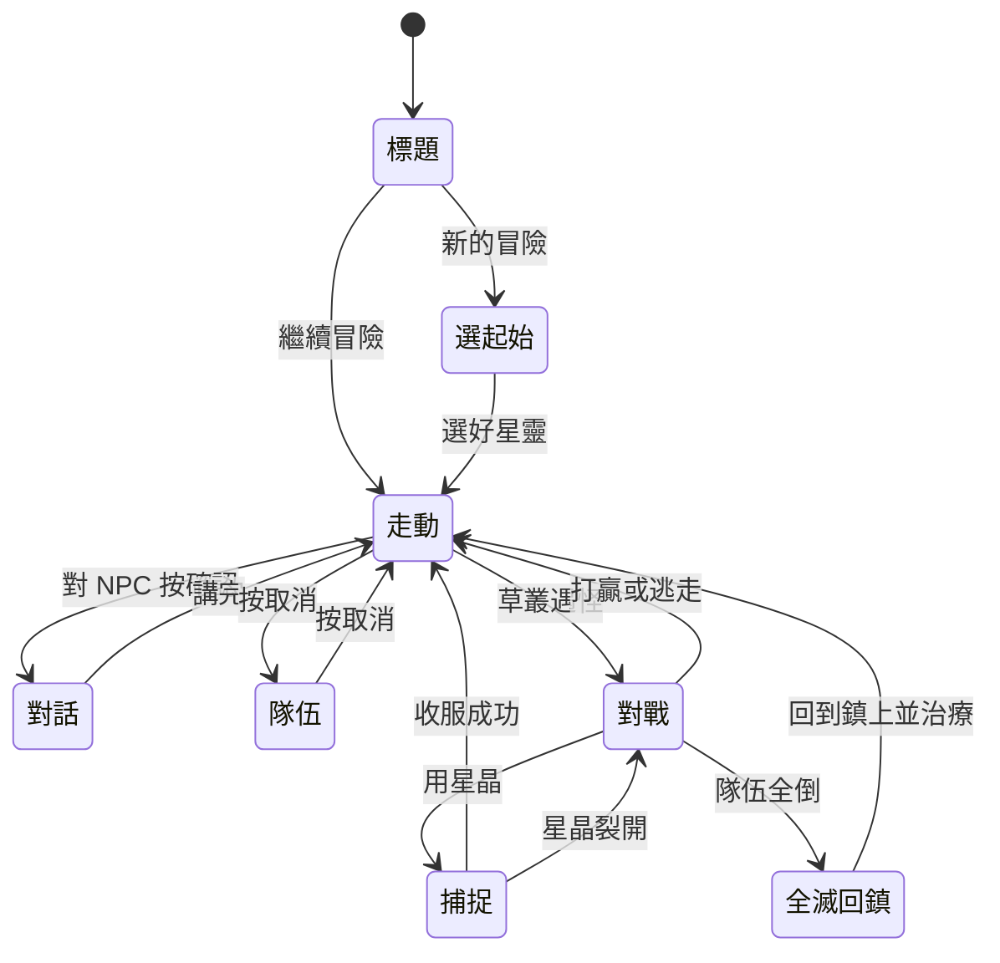
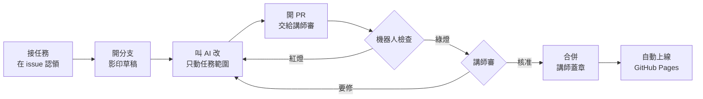

# 底層架構

這份說明遊戲怎麼組起來、哪裡可以蓋、哪裡要先問。

## 分層圖

大家往上蓋的是資料層。規則層和引擎層是底層，資料都交給它們處理，所以新增星靈不用改任何程式。

## 載入與啟動流程

打開 `index.html` 後，引擎先載入。載入器再依編號去找資料檔，找不到的編號直接略過，一整批都沒有就換下一個資料夾。全部載完才開始遊戲，所以不需要任何手動登記的清單。

## 遊戲狀態機

遊戲同一時間只會在一個狀態。`js/main.js` 負責切換，每個狀態自己管畫面和按鍵。全滅的時候回到起始地圖並治療。

## 協作流程

每個改動都走同一條路。機器人先檢查，講師再審，合併後自動上線。

## 想蓋什麼要改哪裡

| 想做的事 | 要改哪裡 | 需要先開 issue 嗎 |
|---|---|---|
| 加一隻星靈 | 新增 `data/monsters/編號.js` | 認領任務並講好編號 |
| 加一個招式 | 新增 `data/moves/編號.js` | 認領任務並講好編號 |
| 加一張地圖 | 新增 `data/maps/編號.js`，連接地圖要加出口 | 認領任務並講好編號 |
| 改 NPC 對話 | 該地圖的資料檔 | 認領任務 |
| 調星靈數值 | 該星靈的資料檔 | 認領任務 |
| 加一種圖塊 | `js/tiles.js` | 要，這是底層 |
| 改傷害、捕捉、升級公式 | `js/rules.js`，同時改 `tests/rules.test.mjs` | 要，這是底層 |
| 加新屬性 | `js/rules.js` 的 `TYPES` 與 `STRONG_AGAINST`，`js/render.js` 的顏色 | 要，這是底層 |
| 改對戰畫面 | `js/battle.js` | 要，這是底層 |
| 改走動畫面 | `js/overworld.js` | 要，這是底層 |
| 改存檔內容 | `js/save.js` | 要，這是底層 |

## 之後可以往上蓋的方向

| 方向 | 內容 |
|---|---|
| 星塔與訓練家 | 有固定隊伍的對手、一層一層往上挑戰的據點 |
| 進化 | 到某個等級變成另一隻星靈 |
| 道具 | 回復藥、不同強度的星晶、背包畫面 |
| 音效 | 用程式合成的走路、攻擊、勝利音效，不用外部音檔 |
| 存檔欄位 | 多個存檔，記錄遊玩時間與圖鑑 |
| 手機優化 | 觸控手感、橫式畫面 |
| 更多地圖 | 洞窟、水路、第二座城鎮 |
| 招式效果 | 降低能力、持續傷害、優先出手 |
